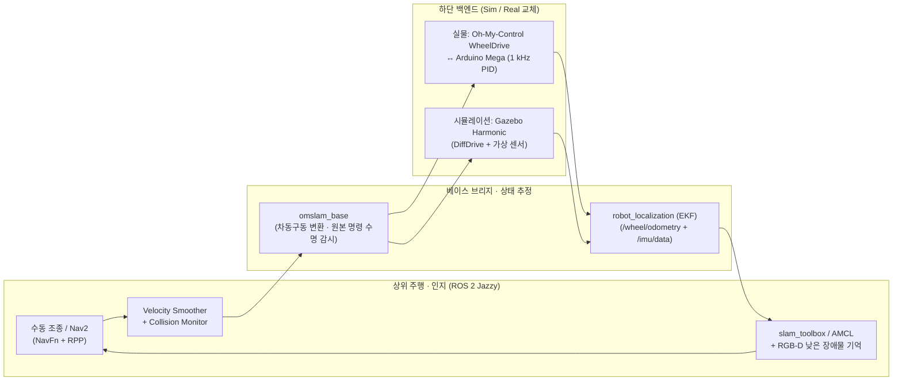

<h1 align="center">Oh_My_SLAM</h1>

<p align="center">
  <em>Oh My MobileRobot의 1 kHz 하드웨어 구동 제어와 ROS 2 SLAM · Nav2 자율주행을 연결하는 통합 워크스페이스</em>
</p>

<p align="center">
  <a href="#overview">프로젝트 구성</a> ·
  <a href="#architecture">시스템 아키텍처</a> ·
  <a href="#roadmap">단계별 로드맵</a> ·
  <a href="#decisions">핵심 설계 원칙</a> ·
  <a href="#docs">상세 문서</a> ·
  <a href="#workspace">작업 환경 · 의존성</a>
</p>

---

**Oh_My_SLAM**은 [`Oh-My-MobileRobot`](https://github.com/Leehyunbin0131/Oh-My-MobileRobot)의 기구·URDF 모델과 [`Oh-My-Control`](https://github.com/Leehyunbin0131/Oh-My-Control)의 **Arduino Mega 1 kHz 모터 제어·센서 보정 계층**을 상위 **ROS 2 자율주행 스택(`slam_toolbox`, `AMCL`, `Nav2`)**으로 통합하는 워크스페이스입니다.

시뮬레이션(**Gazebo Harmonic**)과 실제 로봇(**Jetson Orin Nano Super + Arduino Mega 2560**)이 **동일한 ROS 2 토픽·TF·명령 수명 계약**을 공유하도록 설계하여, 가상 환경에서 검증한 위치추정·지도 작성·경로 주행·장애물 인지 파이프라인을 실물 로봇에 그대로 적용합니다.

> **현재 저장소 상태 (`P0 완료`)**: 시스템 통합 아키텍처, 토픽·TF·명령 수명 계약, 단계별 구현 및 인수 검증 기준(`P1`~`P8`) 수립이 완료된 상태입니다. 실제 ROS 2 패키지와 실행 런치 파일은 아래 로드맵(`P1`~`P8`)에 따라 순차적으로 구현됩니다.

### 핵심 특징

- **시뮬레이션–실물 단일 인터페이스 (`Sim-to-Real`)**: 상위 제어·위치추정·Nav2 구성을 공통으로 유지하고, 최하단 구동·센서 어댑터(`Gazebo DiffDrive` ↔ `Arduino Mega OMR1 USB`)와 기하 보정값만 교체
- **1 kHz 실시간 모터 제어 보존**: Arduino Mega의 20 kHz 엔코더 디코딩·1 kHz 속도 PID·정지 위치 유지(`HOLD`)·300 ms 워치독을 그대로 활용하고, ROS 2 브리지(`omslam_base`)가 원본 명령 시각 보존과 실측 오도메트리를 담당
- **엔코더 + IMU 센서 융합 및 2D SLAM**: 바퀴 엔코더 측정 오도메트리와 검증된 IMU 각속도를 `robot_localization`(EKF)으로 결합(`odom → base_footprint`)하고, 주행 모드에 따라 `slam_toolbox`와 `AMCL`이 `map → odom`을 배타적으로 발행
- **자율주행 및 낮은 장애물 3D 기억 (`Nav2`)**: 보로노이 중심선 선호 비용을 적용한 전역 경로 계획(`NavFn`), 차체 외곽 기반 경로 추종(`RPP`), 라이다 스캔 평면 아래의 낮은 장애물을 감지·보존하는 RGB-D 비용지도 레이어 결합

<a id="overview"></a>

## 전체 프로젝트 구성 (Oh My MobileRobot 생태계)

본 로봇 프로젝트는 **기구 설계 → 하위 제어·보정 → 상위 ROS 2 자율주행**의 3단계 저장소로 구성되어 있습니다.

| 단계 | 저장소 | 담당 역할 및 주요 내용 |
| --- | --- | --- |
| **1. 하드웨어 · 모델** | [`Oh-My-MobileRobot`](https://github.com/Leehyunbin0131/Oh-My-MobileRobot) | 2020 프로파일 프레임, 3D 프린팅 외장 CAD·STL·도면, 구매 부품(BOM), ROS 1/2 URDF 모델 |
| **2. 하위 제어 · 진단** | [`Oh-My-Control`](https://github.com/Leehyunbin0131/Oh-My-Control) | Arduino Mega 1 kHz 폐루프 모터 제어 펌웨어, 모터 PID·IMU 정지 보정, Jetson Orin 수동 조종 및 터미널 진단(TUI) |
| **3. 자율주행 (SLAM · Nav2)** | **`Oh_My_SLAM`** *(현재 저장소)* | 구동 제어기–ROS 2 브리지, Gazebo 시뮬레이션, 실물 2D SLAM(`slam_toolbox` / `AMCL`) 및 `Nav2` 자율주행 통합 |

<a id="architecture"></a>

## 시스템 아키텍처 개요

기준 환경은 **Ubuntu 24.04 · ROS 2 Jazzy · Gazebo Harmonic**입니다.



| 계층 | 구성 요소 | 주요 역할 |
| --- | --- | --- |
| **하위 구동 (MCU)** | `Arduino Mega 2560` + [`Oh-My-Control`](https://github.com/Leehyunbin0131/Oh-My-Control) | 1 kHz 속도 PID 제어, 정지 위치 유지(`HOLD`), 300 ms 명령 유효기간 감시, 20 Hz 엔코더 피드백 |
| **ROS 2 베이스 브리지** | `omslam_base` (`LifecycleNode`) | `/cmd_vel`(`TwistStamped`) 수신·원본 수명 검사, 좌우 바퀴 목표 RPM 변환, 실측 `/wheel/odometry`·`/joint_states` 발행 |
| **상태 추정 · 지도** | `robot_localization`, `slam_toolbox`, `AMCL` | 바퀴 오도메트리 + IMU 각속도 EKF 융합(`odom → base_footprint`), 실시간 지도 작성 또는 저장 지도 위치추정(`map → odom`) |
| **경로 계획 · 안전** | `Nav2`, `omm_perception`, `omm_costmap_layers` | 보로노이 중심선 선호 전역 경로(`NavFn`), 경로 추종(`RPP`), RGB-D 낮은 장애물 기억, `Collision Monitor` 최종 감속/정지 |

<a id="roadmap"></a>

## 단계별 구현 로드맵

하위 구동 계층(`Oh-My-Control`)의 검증된 펌웨어·통신 코어를 기반으로, ROS 2 브리지와 시뮬레이션 검증(`P1`~`P4`)을 먼저 완료한 뒤 실물 로봇(`P5`~`P8`)으로 이행합니다.

| 단계 | 목표 산출물 | 검증 환경 | 현재 상태 |
| --- | --- | --- | --- |
| **P0** | 통합 아키텍처, 토픽·TF·수명 명세, 단계별 인수 기준 및 저장소 구성 | 설계 · 정적 검증 | **완료** |
| **P1** | ROS 구동 브리지(`omslam_base`), 원본 명령 수명 관리, 실측 엔코더 오도메트리 | 단위 시험 · 모의 장치(Mock) | 예정 |
| **P2** | Gazebo Harmonic 공통 인터페이스, 로봇 URDF·가상 센서·TF 통합 | 시뮬레이션 | 예정 |
| **P3** | EKF 상태 추정, `slam_toolbox` 지도 작성·저장, `AMCL` 재위치추정 | 시뮬레이션 | 예정 |
| **P4** | `Nav2` 목표 주행, RGB-D 낮은 장애물 기억 레이어 및 보로노이 중심선 비용 이관 | 시뮬레이션 | 예정 |
| **P5** | Jetson Orin 실물 구동 브리지 배치, 지면 기하(반경·윤거)·IMU·오도메트리 검증 | 실물 로봇 | 예정 |
| **P6** | 실물 수동 주행 SLAM 지도 작성·저장 및 `AMCL` 위치추정 | 실물 로봇 | 예정 |
| **P7** | 실물 저장 지도 기반 `Nav2` 목표점 자율주행 및 장애물 회피·정지 검증 | 실물 로봇 | 예정 |
| **P8** | 실물 온라인 SLAM + `Nav2` 통합 주행 및 운용·복구 절차 확립 | 실물 로봇 | 예정 |

<a id="decisions"></a>

## 핵심 설계 원칙

- **검증된 저수준 제어 코드 재사용**: `Oh-My-Control`의 시리얼 프로토콜(`OMR1`)·구동 보정·`WheelDrive` 모듈은 고정 커밋으로 재사용하며, Arduino Mega에 micro-ROS를 올리거나 호스트로 속도 PID를 옮기지 않습니다.
- **원본 명령 시각 보존과 엄격한 워치독**: 속도 명령 체인은 `TwistStamped`로 통일하고, 중간 평활기(`Velocity Smoother`)를 거치더라도 **최초 명령이 생성된 시각 기준 300 ms 유효기간**을 넘기지 않도록 관리합니다.
- **측정 기반 오도메트리와 단일 TF 소유권**: 목표 명령 적분이 아닌 **실제 엔코더 누적 변화량**과 검증된 IMU 각속도로 오도메트리를 생성하며, `odom → base_footprint`와 `map → odom` 변환은 각 모드에서 단 하나의 노드만 발행합니다.
- **실용적 인지 범위 설정**: 시각 오도메트리(VO/VIO)는 사용하지 않으며, 라이다 높이 아래의 낮은 장애물은 RGB-D 깊이 기반 3D 점유 메모리로 보완합니다(AI 객체 분류·동적 객체 추적·별도 관제 GUI는 본 기본 자율주행 범위에서 제외).

<a id="docs"></a>

## 상세 기술 문서

| 문서 | 주요 내용 |
| --- | --- |
| [**통합 아키텍처 설계**](docs/architecture.md) | 호스트–Mega 연결 구조, 원본 명령 수명과 워치독 계약, 기구학·엔코더 오도메트리, 표준 토픽·QoS·TF 트리 설계 |
| [**단계별 구현 계획**](docs/roadmap.md) | `P0`~`P8` 단계별 선행 조건, 구현 패키지 구성, 실행 모드 및 완료 기준 |
| [**인수 검증 기준**](docs/acceptance.md) | 단계별 통합 시험(`V1`~`V8`) 묶음, 정량적 통과 기준, 실패 주입 범위 및 검증 기록 구조 |
| [**기술 기준과 호환성**](docs/baseline.md) | 기준 OS·ROS 2 패키지 버전, 하드웨어·모델 기하 규격, 기존 시뮬레이션·실물 자산의 이관 범위 |
| [**스킬 평가 기록 규격**](docs/skill-evaluation.md) | 저장소 외부에서 관리하는 ROS 2 스킬 적용 이력 및 효과 분석 기록 형식 |

<a id="workspace"></a>

## 작업 환경과 의존성 관리

- **작업 경로**: 개발 PC는 `~/MyRos/Oh_My_SLAM`, 실물 로봇(Jetson Orin)은 `~/Oh_My_SLAM`을 기준으로 하며, 각 아키텍처(`x86_64` / `ARM64`)에서 독립적으로 빌드합니다.
- **고정 의존성([`dependencies.repos`](dependencies.repos))**: 재사용하는 `Oh-My-Control`(통신·구동 코어)과 `Oh-My-MobileRobot`(URDF·메시 모델)의 기준 커밋을 고정합니다. `external/` 경로는 `colcon` 기본 탐색에서 제외하고 필요한 모듈만 전용 패키지로 설치합니다.
- **데이터 분리**: 실물 실내 지도, 원본 `rosbag`, 장비별 로컬 설정 및 상세 실행 로그(`reports/`)는 Git 저장소 외부에 보관하며, 공개 가능한 검증 요약과 재현 절차만 문서에 기록합니다.

```bash
git clone https://github.com/Leehyunbin0131/Oh_My_SLAM.git
cd Oh_My_SLAM
```

## 라이선스

이 저장소의 신규 코드와 문서에는 [Apache-2.0](LICENSE)을 적용합니다. 재사용하는 로봇 모델(`CERN-OHL-P-2.0`)과 외부 소스에는 각 원본 라이선스가 적용되며, 자세한 출처는 [NOTICE.md](NOTICE.md)를 참고하세요.
