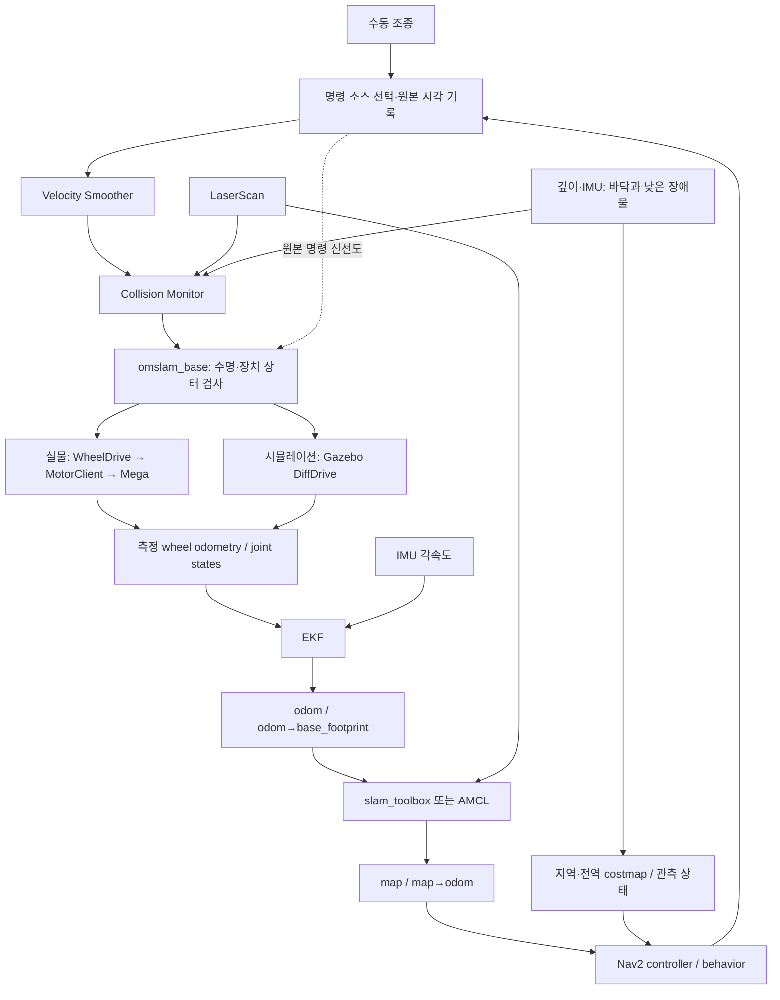
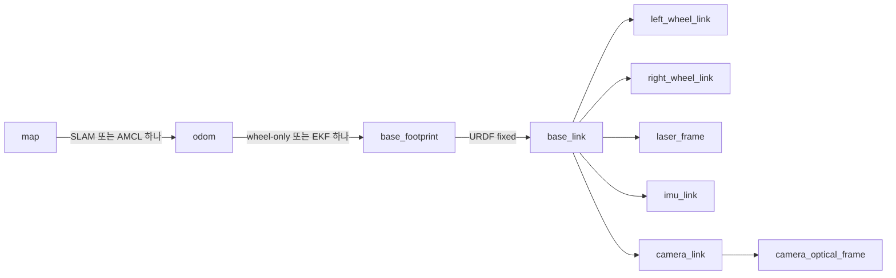

# Mega–ROS 2 통합 아키텍처 설계

[README](../README.md) · [구현 계획](roadmap.md) · [검증 기준](acceptance.md) · [기술 기준](baseline.md)

Arduino Mega 2560 하위 구동 제어기와 상위 ROS 2 자율주행 스택(`robot_localization`, `slam_toolbox` / `AMCL`, `Nav2`)을 연결하는 **데이터 흐름, 원본 명령 수명(Lease) 계약, 기구학·오도메트리, 표준 토픽 및 TF 구조**를 정의합니다. 하드웨어·버전 기준은 [기술 기준과 호환성](baseline.md), 단계별 구현 순서는 [단계별 구현 계획](roadmap.md)을 참고하세요.

## 1. 제어 계층과 연결 방식

| 계층 | 담당 | 유지·신규 여부 |
| --- | --- | --- |
| Arduino Mega | 20 kHz 엔코더, 1 kHz 속도 PID, HOLD, I²C 출력, 명령 만료·고장 감시 | 완료된 펌웨어 유지 |
| `Oh-My-Control` | 시리얼 식별·CRC·ACK, 바퀴 부호/단위 변환, `WheelDrive` | 고정 커밋 재사용 |
| `omslam_base` | ROS 명령 수명, 차동구동 변환, 백엔드 선택, 측정 odom·joint states·진단 | 신규 |
| `robot_localization` | 바퀴 측정과 검증된 IMU yaw rate 결합 | ROS 기존 패키지 설정 |
| `slam_toolbox` / AMCL | 지도 작성 또는 저장 지도 위치추정 | 모드별 하나 선택 |
| Nav2 | 전역 경로·지역 추종·속도 평활·충돌 감시 | 공통 설정과 장비별 제한 분리 |

**1차 구현은 `rclpy` 브리지로 결정합니다.** 이미 검증한 Python 프로토콜·보정·구동 코드를 재사용할 수 있고, Nav2에 필요한 표준 속도 명령·odom·TF를 제공할 수 있기 때문입니다. 메가의 제어 주기는 ROS executor의 실행 주기와 독립적입니다.

`ros2_control + diff_drive_controller`도 차체 속도 변환·피드백 odom·timeout을 제공하는 유효한 대안입니다. 다만 지금 도입하면 하드웨어 플러그인, 시리얼 비동기 read/write, 상태 전환과 기존 Python 계층의 역할을 다시 나눠야 합니다. 이번 기준 경로에는 넣지 않습니다. 향후 교체할 경우에도 아래 ROS 외부 계약은 유지합니다. [Jazzy diff_drive_controller](https://control.ros.org/jazzy/doc/ros2_controllers/diff_drive_controller/doc/userdoc.html)

## 2. 명령·관측 흐름



수동·자율 모드는 명시적으로 전환합니다. 동시에 들어온 명령을 임의로 합치지 않습니다. 초기 구현은 모드별 고정 소스 하나를 선택하며, 조종기와 Nav2의 경쟁이 필요 없는 구조로 시작합니다.

Collision Monitor가 **마지막 속도 평활·장애물 처리 노드**가 됩니다. 그 뒤의 base 브리지는 유효 명령의 단위 변환·상한 축소·차단만 수행하고, 감속 또는 0 명령을 다시 가속하지 않습니다. 실제 센서가 없는 순수 모의 장치 시험은 별도 프로파일로 분리합니다. [Nav2 Collision Monitor 연결](https://docs.nav2.org/jazzy/tutorials/general_tutorials/using_collision_monitor/using_collision_monitor/)

## 3. 원본 명령 수명과 정지

### 메시지와 시각

- 속도 체인은 `geometry_msgs/msg/TwistStamped`를 기준으로 통일합니다. Jazzy 기본값이 `Twist`인 노드는 `enable_stamped_cmd_vel=true`를 명시하고 설치된 버전에서 실제 지원을 확인합니다.
- 키보드가 `Twist`만 제공하면 입력 어댑터에서 처음 한 번 stamp를 부여합니다. 노트북 수동 조종의 입력이 끊겼는데 같은 명령을 영구 재생하는 기능은 허용하지 않습니다.
- 원본 timestamp는 smoother·collision monitor·base를 지나는 동안 보존합니다. smoother의 timestamp 갱신 기능은 끕니다. 설치 버전에서 설정 이름과 출력 보존 동작을 P1에서 확인합니다.
- base는 원본 입력의 나이를 ROS 시각으로 검사한 뒤 같은 프로세스의 monotonic deadline으로 관리합니다. 장치 I/O의 deadline을 `/clock`이나 시스템 시각 점프에 맡기지 않습니다.
- base는 NaN/Inf, 지원하지 않는 횡이동·roll/pitch 속도, 유효하지 않은 frame을 거부합니다. `base_footprint` 기준으로 통일하고 `base_link` 입력을 허용할 때는 두 프레임의 고정 관계를 확인합니다.
- 시뮬레이션은 ROS 시각을 사용하되, 정지·재시작 시 저장한 명령을 폐기합니다. 실물 백엔드는 `use_sim_time=true` 구성을 거부합니다.

### 중요한 기존 API 차이

현재 `WheelDrive.set_target_rpm()`은 호출 시점에 명령 생성 시각을 저장합니다. ROS 수신 이후 큐에서 지연된 명령을 넘기거나 smoother가 같은 stamp로 다시 출력할 때 이를 호출하면 수명이 늘어날 수 있습니다.

따라서 P1에는 **원래 명령 시각을 받는 최소 호스트 API 확장**을 포함합니다. 예: `set_target_rpm(left, right, issued_at=...)`. `issued_at`은 같은 프로세스에서 계산한 monotonic 시각이며, 기본 인수 미지정 시 기존 키보드 동작을 유지합니다. 같은 원본 stamp의 평활 출력은 목표값을 바꿀 수 있지만 deadline을 갱신하지 않습니다. 만료·미래 시각·역행 입력은 거부합니다.

이 변경은 메가 펌웨어·OMR1 프로토콜을 바꾸지 않습니다. 공통 라이브러리의 작은 호환 변경은 `Oh-My-Control`에 반영하고 `dependencies.repos`의 커밋을 갱신합니다. ROS 노드·기구학·launch·검증은 모두 `Oh_My_SLAM`에서 구현합니다. 검증 없이 private 속성을 직접 덮어쓰는 어댑터는 만들지 않습니다.

### watchdog과 상태

| 상황 | 동작 |
| --- | --- |
| 유효한 새 이동 명령 | 좌우 목표 계산, 최대 50 Hz 송신 |
| 유효한 새 0 명령 | 0 RPM 감속/HOLD; 소스가 계속 새 0 명령을 제공하는 동안 유지 가능 |
| 원본 명령이 300 ms 만료 | `STOP`, 이전 목표 삭제; 0 명령을 새 의도로 영구 재생하지 않음 |
| 같은 명령의 50 Hz 재송신 | 원본 deadline까지 남은 시간만 MCU lease로 전달 |
| MCU가 허용하는 100 ms보다 lease가 짧음 | 추가 송신 중단, 마지막 lease의 만료 보장 |
| 장애물 또는 명시적 정지 출력 | 일반 송신 주기보다 즉시 우선 처리. 원본 deadline 안에 유효한 0 RPM lease를 만들 수 없으면 즉시 `STOP` |
| 피드백 400 ms 중단·MCU fault·프로토콜 오류 | 출력 해제 시도, fault 상태 고정, 명시적 복구 전 재구동 금지 |
| 입력 소스 또는 Collision Monitor 중단 | 원본/최종 명령 신선도 각각 확인 후 차단 |
| deactivate·종료·재접속·MCU 재부팅 | 과거 목표 폐기, 새 식별·피드백·활성화·새 명령 필요 |

원본 명령 토픽도 감시하여 smoother가 timeout 후 생성한 새 stamp의 0 메시지를 새 운전자 의도로 오인하지 않습니다. 정상 정지와 장애물 정지는 유효한 소스가 있는 동안 HOLD할 수 있지만, 소스 단절은 출력 해제입니다. Nav2 목표 종료 뒤 0 출력이 끝나도 최종적으로 정지·출력 해제 상태여야 합니다.

특히 원본 명령이 200 ms 이상 지난 뒤 같은 stamp의 장애물 정지 출력이 도착하면, 최소 100 ms lease 조건 때문에 0 명령을 생략해서는 안 됩니다. 이때는 `STOP`이 우선하며 이전 nonzero를 deadline까지 유지하지 않습니다. 위의 최소 lease 규칙은 일반 이동 재송신에 적용합니다.

300 ms는 **명령의 유효기간**입니다. 실제 정지 완료 시간·제동 거리는 속도와 지면에 따라 별도 측정합니다. 명령 만료와 물리적 정지를 같은 결과로 기록하지 않습니다.

### 시리얼 소유권

하나의 I/O worker만 `MotorClient`를 소유합니다. ROS 콜백은 최신 명령 1개와 원본 시각을 전달하며, 블로킹 ACK 대기를 executor 안에서 수행하지 않습니다. I/O worker는 수신·`WheelDrive.tick()`·오류 상태를 갱신하고 ROS 쪽에는 측정 snapshot을 제공합니다. 활성 중 별도 `teleop.sh`·진단 도구가 같은 USB를 열지 못하도록 exclusive 접근과 사전 확인을 사용합니다.

## 4. 기구학과 엔코더 odometry

좌표계는 전진 +X, 왼쪽 +Y, 위 +Z, 좌회전 +yaw입니다. 물리적 좌우 바퀴에 대해 전진 RPM을 양수로 정의하고, 실제 드라이버·엔코더 부호는 기존 `DriveCalibration`에서 한 번만 변환합니다. [REP 103](https://github.com/ros-infrastructure/rep/blob/master/rep-0103.rst)

차체 선속도 `v`, 각속도 `w`, 유효 윤거 `b`, 좌우 유효 반경 `rL/rR`에 대해:

```text
omega_L = (v - w*b/2) / rL
omega_R = (v + w*b/2) / rR
rpm_L/R = omega_L/R * 60 / (2*pi)
```

바퀴 상한을 넘으면 좌우에 같은 비율을 곱해 곡률을 보존합니다. 작은 명령을 임의로 30 RPM까지 올리지 않습니다. 기본 실물 시험이 성공한 30 RPM과 Nav2의 목표 근처 저속 제어 가능 범위는 별도로 확인합니다.

현재 모델의 `r=0.068 m`, `b=0.480 m`는 초기값입니다. 이 값에서는 30 RPM 직진이 약 0.214 m/s, 양쪽 ±30 RPM 제자리 회전이 약 0.890 rad/s입니다. 실물 유효 반경·윤거는 지면에서 거리·회전각으로 보정합니다. 실물 운용 상한 95 RPM은 MCU 보호 상한 100 RPM과 구분하며, 시뮬레이션도 공통 운용 상한 95 RPM을 따르게 합니다.

odometry는 **측정 엔코더 변화량**으로 계산합니다.

```text
delta_sL = rL * delta_phiL
delta_sR = rR * delta_phiR
delta_s  = (delta_sR + delta_sL) / 2
delta_yaw = (delta_sR - delta_sL) / b
```

SE(2) 원호 적분을 사용하고 회전량이 매우 작은 경우 직선 극한을 처리합니다. 목표 RPM이나 마지막 `/cmd_vel`을 적분해 실물 측정 odom으로 표시하지 않습니다. MCU tick wrap, 재부팅, 수신 batch, 중복 sample은 구분합니다. 새로운 encoder sample에만 20 Hz 수준의 wheel odom·joint states를 발행하고, MCU 시간 증가량을 적분 주기로 사용합니다. ROS stamp 변환의 초기 offset과 재동기화 기준을 둡니다.

`/joint_states`는 `left_wheel_joint`, `right_wheel_joint`의 실제 누적 rad·rad/s를 제공합니다. 양쪽 URDF joint axis는 +Y이며 물리적 전진 방향과 맞는지 확인합니다. `base_footprint`는 구동축 중점의 지면 투영이고 차체 외곽의 중앙이 아닙니다.

## 5. 토픽·QoS 계약

아래 이름은 새 워크스페이스의 **계획된 표준 이름**입니다. 기존 드라이버의 토픽은 bringup에서 명시적으로 remap합니다.

| 토픽 | 타입 | 발행·소비 | 초기 주기 / QoS |
| --- | --- | --- | --- |
| `/cmd_vel/teleop`, `/cmd_vel/nav` | `TwistStamped` | 수동/자율 입력 → 소스 선택 | 새 의도 20 Hz 목표; reliable, volatile, depth 1 |
| `/cmd_vel/requested` | `TwistStamped` | 선택 소스 → smoother·freshness 감시 | 원본 stamp 유지 |
| `/cmd_vel/smoothed` | `TwistStamped` | smoother → collision monitor | 50 Hz 목표 |
| `/cmd_vel` | `TwistStamped` | collision monitor → base | 유효 원본 stamp; reliable, volatile, depth 1 |
| `/wheel/odometry` | `nav_msgs/Odometry` | base/sim → EKF | 새 측정 20 Hz 실물; reliable, volatile |
| `/joint_states` | `sensor_msgs/JointState` | base/sim → robot_state_publisher | 새 측정에 맞춤 |
| `/imu/data` | `sensor_msgs/Imu` | 선택 IMU → EKF | 장치 실제 주기; sensor-data QoS와 호환 |
| `/odom` | `nav_msgs/Odometry` | EKF → Nav2·진단 | 초기 50 Hz, 실측 입력 증가를 의미하지 않음 |
| `/scan` | `sensor_msgs/LaserScan` | 라이다 → SLAM/AMCL/costmap | 실제 약 10 Hz 기준, best effort/volatile |
| `/camera/depth/image_rect_raw`, `/camera/depth/camera_info` | `Image`, `CameraInfo` | D435i/가상 센서 → 인지 | 실제 frame·단위·intrinsics 확인 |
| `/perception/health`, `/perception/memory` | 기존 이관 메시지 | 인지 → guard/costmap | 메시지 정의를 이관 시 고정 |
| `/map` | `nav_msgs/OccupancyGrid` | SLAM 또는 map_server | map 소비 QoS에 맞는 transient local |
| `/diagnostics` | `DiagnosticArray` | base·상태 감시 → 관측 | 1 Hz + 상태 변화 |

QoS는 이름만 맞추는 것으로 끝내지 않고 endpoint의 offered/requested profile을 확인합니다. 동기화가 필요한 RGB-D·IMU의 timestamp 및 TF 유효 시각도 기록합니다.

## 6. TF·위치추정 소유권



도식의 센서 연결은 개념 경로이며 실제 `lidar_link` 등 중간 링크는 원본 URDF를 유지합니다. `camera_optical_frame`은 Z 전방·X 우측·Y 하방입니다. 실물 장착 자세는 CAD 값과 별도로 확인합니다.

| 모드 | `odom → base_footprint` | `map → odom` |
| --- | --- | --- |
| P1/P2 wheel-only | base wheel odom 또는 Gazebo 중 하나 | 없음 |
| EKF 적용 후 sim·real | EKF만 | 모드에 따라 아래 선택 |
| 수동/온라인 지도 작성 | EKF | `slam_toolbox` |
| 저장 지도 주행 | EKF | AMCL |

EKF 활성 시 raw wheel odom·Gazebo·기존 ICP odometry의 odom TF 발행을 끕니다. 기존 `icp_odometry`는 새 기본 경로에서 실행하지 않습니다. `map → base_link`를 별도로 직접 발행하지 않습니다. [REP 105](https://github.com/ros-infrastructure/rep/blob/master/rep-0105.rst), [Nav2 robot_localization](https://docs.nav2.org/jazzy/configuration_and_development/first_time_robot_setup_guide/odom/setup_robot_localization/)

EKF는 `two_d_mode=true`, `world_frame=odom`, `base_link_frame=base_footprint`를 출발점으로 합니다. 처음에는 wheel의 `vx`, `wz`와 한 IMU의 `wz`를 사용하고, 같은 엔코더에서 나온 pose와 twist를 독립 측정처럼 중복 결합하지 않습니다. 무횡이동 `vy=0` 제약과 covariance는 차체의 미끄러짐 조건을 보고 설정합니다. 자기장 yaw·선형 가속도·두 IMU 동시 결합은 기본값에 넣지 않습니다.

HFI-A9를 1차 yaw-rate 후보로 두되 축·bias·timestamp 검증을 먼저 수행합니다. D435i IMU는 깊이 바닥 추정과 센서 상태 확인에 사용할 수 있습니다. 카메라 pose·VO/VIO는 도입하지 않습니다.

## 7. 시뮬레이션과 실물의 경계

| 항목 | 시뮬레이션 | 실물 |
| --- | --- | --- |
| 구동 하단 | Gazebo DiffDrive 어댑터 | OMR1 USB 어댑터 |
| ROS 시각 | `/clock`, `use_sim_time=true` | 시스템 시각, `use_sim_time=false` |
| domain | 기존 86을 격리 프로파일로 사용 | 기존 11; 실제 배치 전 충돌 확인 |
| odom 입력 | 가상 wheel feedback | 실제 encoder feedback |
| 센서 | 가상 LaserScan/IMU/RGB-D | RPLIDAR/D435i/HFI-A9 |
| 기하 | CAD 초기값 | 지면 보정값·장착 실측값 |
| 검증용 truth | 별도 sim truth만 사용 | 줄자·각도 기준·관찰/측정 로그 |

Gazebo truth는 SLAM·EKF·Nav2 입력으로 사용하지 않습니다. 순수 시뮬레이션 통과는 USB·메가 PID·실제 마찰·MCU 차단 시간의 검증이 아닙니다. 프로토콜 mock 시험과 Gazebo 주행 시험의 결과도 분리합니다.

## 8. Nav2·인지의 기본 선택

- **공통 전역·지역 제어기 기준 (`NavFn` + `RPP`)**: 시뮬레이션과 실물 모두 첫 자율주행 기준을 `NavFn` 전역 계획기와 `Regulated Pure Pursuit (RPP)` 제어기로 통일하여 주행 특성 비교와 원인 분리를 명확히 합니다(`MPPI`·`State Lattice`는 기본 경로의 필수 항목에 포함하지 않음).
- **보로노이 중심선 선호 레이어**: 보로노이 중심선은 별도의 전역 계획기가 아니라 **전역 비용지도(Costmap)의 선호 비용 레이어**로 결합하여, `NavFn`이 장애물과 충분한 여유를 둔 통로 중심선 경로를 선택하도록 유도합니다.
- **RGB-D 낮은 장애물 기억**: 라이다 스캔 높이 아래에 있는 낮은 장애물은 깊이 카메라 기반 바닥 분리 및 3D 점유 메모리(`omm_perception` / `camera_memory` 레이어)로 감지하고, 시야 밖으로 벗어나도 지역·전역 비용지도에 유지합니다(라이다 정적 SLAM 지도와 임시 장애물 메모리는 분리).
- **루프 클로저 시 장애물 메모리 정합**: 장애물 메모리가 `odom` 프레임 기준일 때 루프 클로저로 `map → odom` 변환이 크게 보정되면 재투영 또는 무효화 규칙을 적용하며, 미관측 영역이나 깊이 무효값을 자유 공간(Free space)으로 오인하지 않습니다.
- **보수적 회복(Recovery) 동작**: 실물 로봇의 초기 회복 동작은 **정지·대기·재계획**을 우선하며, 자율 후진이나 제자리 회전 회복은 차체 외곽(Footprint)과 후방 센서 관측 범위가 검증된 조건에서만 허용합니다.
- **연산 자원 배분**: Jetson Orin에서 구동 제어·위치추정·Nav2를 실행하고, 무거운 Gazebo 시뮬레이터와 RViz 시각화는 개발 PC에서 실행합니다. CPU 부하로 제어 주기가 지연될 때는 카메라 해상도·프레임레이트나 시각화 전송량을 먼저 조정하며, 안전 워치독 기준을 임의로 완화하지 않습니다.

## 9. 실행 모드와 준비 조건

아래는 구현할 launch 계약입니다. 공통 `backend=sim|real`과 `mode`를 한 곳에서 결정하고, 개별 launch가 서로 다른 odom·map 발행자를 추가하지 못하게 합니다.

| 모드 | 주요 구성 | 구동 활성화에 필요한 조건 |
| --- | --- | --- |
| `base_check` | base·joint states·wheel odom, 필요 센서만 | 새 장치 식별·피드백·명시적 활성화·새 수동 명령 |
| `manual_mapping` | base·센서·EKF·SLAM | 위 조건과 센서/TF 유효성; 자율 command source 미실행 |
| `localization` | 센서·EKF·map_server·AMCL | 기본 구동 비활성, 위치추정 확인용 |
| `navigation` | localization + Nav2 + smoother/collision monitor | 지도 위치 초기화·localization/센서 상태·Nav2 lifecycle·fresh command |
| `slam_navigation` | EKF·SLAM + Nav2 + smoother/collision monitor | SLAM map/TF 준비·센서 상태·Nav2 lifecycle·fresh command |

기본 startup에서 base는 이동 명령을 받지 않습니다. 모드별 준비 조건이 충족된 뒤 활성화하고, 설정 변경·모드 전환 시 먼저 명령 수락을 해제합니다. 이전 입력이 큐나 latched 상태로 남아 재출발하지 않게 합니다. 센서 단절로 차단된 상태에서의 재개 조건도 모드별로 명시합니다.
