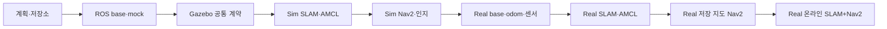

# 단계별 구현 계획

[README](../README.md) · [통합 설계](architecture.md) · [검증 기준](acceptance.md) · [기술 기준](baseline.md)

`Oh_My_SLAM` 워크스페이스의 단계별(`P0`~`P8`) 구현 범위, 선행 조건, 핵심 산출물과 완료 기준을 정의합니다. 시뮬레이션(`P1`~`P4`)에서 인터페이스와 주행 스택을 먼저 검증한 뒤 동일 계약을 실물 로봇(`P5`~`P8`)에 적용합니다.

## 진행 원칙

1. P1의 명령·측정 계약을 먼저 고정하고, P2–P4 시뮬레이션을 통과한 동일 인터페이스를 실물에 연결합니다.
2. 단계마다 관련 검사를 한 실행 묶음으로 수행합니다. 변경이나 새 실패가 없으면 통과한 검사를 반복하지 않습니다.
3. 빌드 실패 시 그 산출물에 의존하는 실행 검증을 중단합니다. 설치 경로와 소스 커밋이 맞는 경우에만 결과를 인정합니다.
4. 코드 문제는 자동화 시험으로 먼저 확인하고, 실물 확인이 필요한 항목은 짧은 사용자 시험에 묶습니다.
5. 기존 저수준 구동 완료 상태는 유지합니다. 새 ROS 경로에서 달라지는 명령·TF·odom·상위 동작만 검증합니다.
6. 숫자형 합격 기준은 [acceptance](acceptance.md)의 **초기 프로젝트 기준**입니다. 실측 근거 없이 통과 판정을 위해 완화하지 않습니다.

## P0. 저장소·설계 기준

**산출물**

- 공개 GitHub 저장소 `Oh_My_SLAM`, 개발 PC의 `~/MyRos/Oh_My_SLAM`.
- 통합 설계, 단계별 계획, 검증 기준, 기존 환경·코드의 출처.
- 고정 커밋을 적은 `dependencies.repos`, 계획된 `src/` 구조, 생성물 제외 규칙.
- 사용자 작업 규칙을 담은 `AGENTS.md`.

**완료 조건:** 문서 간 토픽·TF·단계·타임아웃이 일치하고, 의존성 커밋이 존재하며, 로컬 커밋이 공개 저장소에 반영됨. 실행할 ROS 패키지가 없으므로 colcon 빌드나 실물 시험을 수행하지 않습니다.

## P1. ROS 구동 브리지와 측정 오도메트리

**선행:** P0, `Oh-My-Control` 고정 기준.

**구현 순서**

1. `omslam_control_vendor`가 고정된 공통 모듈만 설치하도록 구성합니다. 임의의 홈 디렉터리·기존 overlay·전역 `PYTHONPATH`에 의존하지 않게 합니다.
2. `omslam_base`에 차동구동 변환, 바퀴 상한 축소, 엔코더 SE(2) odometry, timestamp/deadline 처리를 ROS와 분리된 작은 모듈로 작성합니다.
3. 호스트 `WheelDrive`에 원본 monotonic 시각을 전달하는 호환 API를 추가하고, 새 명령과 같은 stamp의 평활 출력 갱신을 구분합니다. 작은 의존성 변경만 별도 커밋하고 버전을 고정합니다.
   장애물·명시적 정지는 송신 주기보다 우선하며, 남은 lease가 100 ms 미만이면 즉시 `STOP`으로 처리합니다.
4. `rclpy.lifecycle.LifecycleNode` 기반 브리지를 작성합니다. configure에서 설정 검증·장치 준비, activate에서 명령 수락, deactivate/error에서 목표 폐기·출력 해제를 처리합니다.
5. 시리얼 단일 소유 worker, 최신 값 1개 큐, `MockMotorClient`를 연결합니다. ROS callback에서는 ACK를 기다리지 않습니다.
6. `/wheel/odometry`, `/joint_states`, `/diagnostics`와 명령 소스 감시를 추가합니다. 기본 시작은 비활성/장치 미연결 프로파일입니다.

**핵심 산출물:** ROS base 패키지, vendor 패키지, mock adapter, 명령·피드백 단위 시험, 설정 예제, `base.launch.py`.

**필수 검증 V1:** 직진/회전·부호·곡률 보존, 원본 timestamp를 보존한 재송신, 명령/피드백 중단, delayed queue·같은 stamp 반복·fault·재접속, 알려진 엔코더 변화량의 odom, 최신 설치본의 토픽 타입. 모의 장치로 한 번에 묶습니다.

**완료 조건:** 코드와 설치본에서 동일한 계약이 확인되고 stale nonzero가 다시 활성화되지 않음. 이 단계는 실물 구동 검증을 주장하지 않습니다.

## P2. 시뮬레이션 하단과 공통 TF

**선행:** P1.

**구현**

- 원본 CAD 설명 패키지를 고정 버전으로 가져오고 `omslam_description`에서 launch·장비별 extrinsic 설정을 제공합니다. 모델 원점·관절 이름·원본 라이선스를 유지합니다.
- `omslam_sim`에 기존 Gazebo Harmonic 모델 생성기, 방·통로·좁은 코너·낮은 장애물 월드를 필요한 순서로 이관합니다.
- P1과 같은 명령 수명·속도 상한을 적용하고 최하단에서만 Gazebo용 메시지로 변환합니다.
- Gazebo의 wheel odom을 `/wheel/odometry`로 연결합니다. EKF를 켜면 Gazebo odom TF는 끕니다.
- 가상 라이다·IMU·RGB-D의 frame·stamp·QoS, `use_sim_time`을 통일합니다. 별도 truth 토픽은 검증 도구만 구독합니다.
- 시뮬레이션도 실물 운용 상한 95 RPM을 사용합니다. 100 RPM 보호 상한을 기본 주행 상한으로 가져오지 않습니다.

**산출물:** `sim.launch.py`, 기본 robot profile, 센서 bridge 설정, RViz 설정.

**필수 검증 V2:** 단일 짧은 sim 주행에서 전진·좌회전 부호, odom/관절 이동, TF 단일 발행자, 센서 시각, 명령 중단과 pause/resume을 함께 확인합니다.

**완료 조건:** 동일 ROS 계약으로 sim base가 동작하고 USB 장치에 접근하지 않음. 실제 Mega 1 kHz PID를 시뮬레이션했다고 표현하지 않습니다.

## P3. 시뮬레이션 SLAM과 저장 지도 위치추정

**선행:** P2.

**구현**

- `omslam_localization`에서 wheel-only 진단 모드와 EKF 모드를 구분합니다. EKF는 실제 측정 입력만 사용합니다.
- `omslam_mapping`의 `mapping.launch.py`에 `slam_toolbox` 비동기 2D mapping을 연결합니다. 시작 해상도는 0.05 m입니다.
- 지도 저장 도구는 occupancy map(`yaml` + `pgm/png`)과 SLAM pose graph를 함께 저장합니다. 저장 메타데이터에는 backend, commit, frame, geometry/calibration 식별값을 남깁니다.
- SLAM을 종료하고 `localization.launch.py`에서 map_server+AMCL을 시작합니다. 초기 자세 지정과 laser-map 정합을 확인합니다.
- mapping과 localization을 상호 배타적인 launch 모드로 만듭니다.

**필수 검증 V3:** 방/통로의 짧은 폐루프 주행 → loop closure → 두 형태 저장 → 재시작 → AMCL 재위치추정을 한 시나리오로 확인합니다.

**완료 조건:** 지도와 저장 파일이 재사용 가능하고, `map → odom`에 중복 발행자가 없으며, sim truth 대비 초기 오차 기준을 통과함.

## P4. 시뮬레이션 Nav2와 기존 기능 이관

**선행:** P3.

**구현 순서**

1. 공통 NavFn + RPP, footprint, 목표/진행 판정, smoothing, Collision Monitor를 연결합니다. sim·실물의 초기 controller를 같게 합니다.
2. 목표 도착·취소·재출발·막힌 경로의 대기/실패 반환을 확인합니다. 무한 recovery를 기본으로 두지 않습니다.
3. 기존 `omm_perception`·메시지·camera memory costmap을 이관합니다. 낮은 장애물 감지, 시야 밖 보존, 재관측 빈 공간 삭제, 데이터 중단 차단을 확인합니다.
4. 보로노이 선호 cost layer를 추가합니다. lethal/unknown 비용과 좁은 통로 충돌 판정을 침범하지 않게 합니다.
5. 온라인 SLAM을 켠 상태의 Nav2도 별도 모드로 구성하고, 지도 갱신·loop closure와 장애물 기억의 좌표 변환을 확인합니다.

**산출물:** `omslam_navigation`, 이관한 인지·costmap 패키지, `navigation.launch.py`, `slam_navigation.launch.py`, 최소 BT.

**필수 검증 V4:** 서로 다른 의미를 확인하는 최소 월드 집합으로 묶습니다. 기본 방(도착/취소), 코너·좁은 통로(footprint/중심선), 낮은 상자(인지/기억), 막힌 통로(안전한 실패)를 각 한 번 수행합니다. 관련 없는 월드를 추가하지 않습니다.

**완료 조건:** V4 통과, sim controller 명령이 MCU 운용 한도와 원본 timeout 계약을 지킴. MPPI·State Lattice 전체 비교 실험은 기본 필수 검사가 아닙니다.

## P5. 실물 ROS 구동·기하·IMU·오도메트리

**선행:** P4. Orin이 연결되고 사용자가 실물 시험 가능한 상태여야 합니다.

**배치**

- Orin `~/Oh_My_SLAM`에서 같은 commit을 checkout하고 ARM64로 빌드합니다. 기존 `~/ros2_dev_ws`, `~/robot_mapping_ws`의 소스·보정·지도는 보존합니다.
- 새 셸에서 `/opt/ros/jazzy`와 새 install만 source합니다. 기존 launch의 자동 실행·중복 USB 접근·ICP/Gazebo TF 발행을 확인합니다.
- 실제 사용 보정값을 장비별 로컬 설정으로 명시적으로 로드합니다. 저장소 예제 설정이 실물 보정값을 덮어쓰지 않게 합니다.
- 라이다·D435i·HFI-A9는 기존 동작 가능한 드라이버를 재사용하고 토픽·frame만 표준 계약에 맞춥니다.

**실물 시험 순서 — 한 번의 준비된 세션에 묶음**

1. 모터 전원을 끈 상태: 최신 설치 경로, 시리얼 식별·피드백, ROS 메시지·설정, 센서 frame/QoS/time 확인. USB open이 메가를 재부팅할 수 있으므로 초기화 이후의 새 피드백을 요구합니다.
2. 바퀴를 띄운 상태: 새 ROS 경로의 전진·후진·좌/우회전·정지, source 중단, 브리지 종료 후 출력 해제를 확인합니다. 기존 저수준 검사 전체를 재실행하지 않습니다.
3. 지면: 표식 사이 1 m 직진과 양방향 회전/사각형 주행으로 유효 반경·윤거, 실제 방향, 속도·정지/재출발, 필요한 저속 구간을 측정합니다.
4. IMU 정지 bias·중력 방향·좌회전 yaw-rate 부호와 timestamp를 확인하고 EKF에 한 센서만 연결합니다.
5. wheel-only와 EKF의 위치·속도 오차를 같은 기록에서 비교합니다. 보정 변경이 생기면 영향을 받은 기하 주행만 확인합니다.

**필수 검증 V5:** 위 세션의 결과, 기록한 `/wheel/odometry`, `/imu/data`, `/odom`, TF, 명령·MCU 상태를 하나의 보고서로 묶습니다. ROS 계층이 붙은 뒤 새로 생기는 동작만 판정합니다.

**완료 조건:** 실제 거리/회전각 기준과 TF/시간 기준 통과, Nav2가 요구할 저속·회전·감속 범위 확보, 데이터 중단 시 과거 명령의 재활성화 없음.

저속 응답이 부족하면 결과가 확인된 속도·가속도 범위로 Nav2를 제한합니다. 정밀 도착이 불가능할 정도로 실제 결함이 확인된 경우에만 구동 계층 수정으로 돌아갑니다. 30 RPM 강제 증폭으로 해결하지 않습니다.

## P6. 실물 수동 SLAM과 AMCL

**선행:** V5 통과.

**구현·시험**

- 새 workspace의 wheel/EKF odom을 사용하여 작은 실제 공간부터 수동 mapping을 시작합니다. 첫 실물 mapping 중에는 Nav2가 구동 명령을 내리지 않습니다.
- 직선·회전·폐루프가 포함된 짧은 코스로 스캔 정합, 중복 벽, 누락, loop closure를 확인합니다.
- 실물 map과 pose graph를 저장하고 metadata에 실제 calibration hash·backend를 기록합니다.
- 종료 후 AMCL 모드로 재시작하여 시작 표식과 다른 표식에서 초기 자세·laser-map 정합을 확인합니다.
- 기존 2026-11-10 지도는 참고자료로 유지하고, 새 odom·TF의 통과 근거로 대체 사용하지 않습니다.

**필수 검증 V6:** 한 mapping 기록과 저장/재시작 기록, 두 기준 위치의 오차. 새 센서 전체 시험을 반복하지 않습니다.

**완료 조건:** 지도·pose graph 저장 성공, 실측 기준과 일치하는 재위치추정, TF 중복·시간 역행·지속적인 scan drop 없음.

## P7. 실물 저장 지도 Nav2

**선행:** V6, sim에서 해당 인지·보로노이 검증 완료.

**진행**

- P5에서 확인한 속도·가속도·yaw 한도로 시작합니다. 95 RPM은 상한이며 처음부터 그 속도로 시험하지 않습니다.
- 실물 footprint와 padding, 실제 stop distance를 반영한 충돌 감시 영역을 적용합니다. 뒤쪽 관측이 충분하지 않으면 자율 후진 recovery를 켜지 않습니다.
- P4의 NavFn+RPP를 그대로 기반으로 하고 장비별 기하·센서 timeout·제동 한도만 조정합니다.
- 목표 3개(직선, 회전/코너, 복귀)를 연결해 도착과 방향 정합을 확인합니다. 한 목표에서 cancel→정지→새 목표를 확인합니다.
- 라이다 높이보다 낮은 상자, 시야 밖 장애물 기억, 보로노이 선호가 필요한 통로를 확인합니다. 카메라가 유효하지 않을 때 guard가 제한/차단하는 모드를 일관되게 적용합니다.
- 사람이 없는 조건에서 센서 데이터 중단 또는 프로세스 중단을 한 번 주입하고 정지·복구를 확인합니다. 실제 사람을 충돌 시험 대상으로 사용하지 않습니다.

**필수 검증 V7:** 위 경로·취소·장애물 시나리오를 하나의 실물 주행 세션으로 묶습니다. 출발/도착 위치·yaw 오차, 정지 거리, 최소 장애물 여유, timeout·fault, CPU/메모리와 제어 주기를 함께 기록합니다.

**완료 조건:** 목적지 도착/취소와 장애물 처리 기준 충족. 단순 lifecycle active, 경로 생성, `motor:=false` 실행은 실물 Nav2 완료로 판정하지 않습니다.

## P8. 실물 온라인 SLAM+Nav2와 운용 정리

**선행:** 저장 지도 주행 V7 통과.

**구현·검증**

- AMCL 대신 `slam_toolbox`가 `map → odom`을 맡는 `slam_navigation` 모드를 사용합니다.
- 알려진 자유 공간 안에서 목표를 주고 지도가 확장되는 동안 주행합니다. frontier 자동 탐색은 이번 범위에 넣지 않습니다.
- loop closure 시 전역 경로와 장애물 메모리를 갱신하며, 로컬 odom은 연속성을 유지합니다. 큰 위치 보정 후 유효한 경로가 준비되기 전에는 이동하지 않습니다.
- 지도 작성·저장 지도 주행·온라인 SLAM 주행의 시작/종료 순서를 문서화합니다. 모드 변경은 중립 상태에서 목표·구동 권한·이전 명령을 폐기한 후 수행합니다.
- 같은 commit·설정·저장 지도를 기준으로 재시작하여 정상적으로 복구되는지 확인합니다. 부팅 시 무조건 자율 구동하는 서비스는 추가하지 않습니다.

**필수 검증 V8:** 작은 공간에서 지도 확장·코너 목표·loop closure·지도 저장·정상 종료/재시작을 한 시나리오로 확인합니다.

**완료 조건:** V8 통과, 재현 가능한 실행 절차와 rollback 경로 정리. 운영에 필요한 소스·보정·지도 버전이 구분되어 있음.

## 저장소 구현 단위

| 순서 | 주요 변경 | 완료 검증 |
| --- | --- | --- |
| 1 | vendor 설치·기구학·명령 시각 계약 | V1의 pure/mock 부분 |
| 2 | ROS base lifecycle·측정 메시지·장치 worker | 나머지 V1 |
| 3 | description/sim·센서/TF·EKF | V2 |
| 4 | mapping·저장 도구·AMCL 모드 | V3 |
| 5 | Nav2 공통 설정·인지/보로노이 이관 | V4 |
| 6 | Orin 배치·장비 profile·실측 보정 | V5 |
| 7 | 실물 map·위치추정·운용 기록 | V6 |
| 8 | 실물 목표 주행 설정과 기록 | V7 |
| 9 | 온라인 SLAM 주행·재시작 절차 | V8 |

기간은 실제 보정과 실물 시험 가능 시간에 좌우되므로 근거 없는 일정을 고정하지 않습니다. 선행 단계의 통과 결과로 다음 작업을 판단합니다. 서로 독립적인 소스 조사·장시간 빌드/시험은 하위 에이전트에 위임하되 동일 시험을 중복 수행하지 않습니다.
